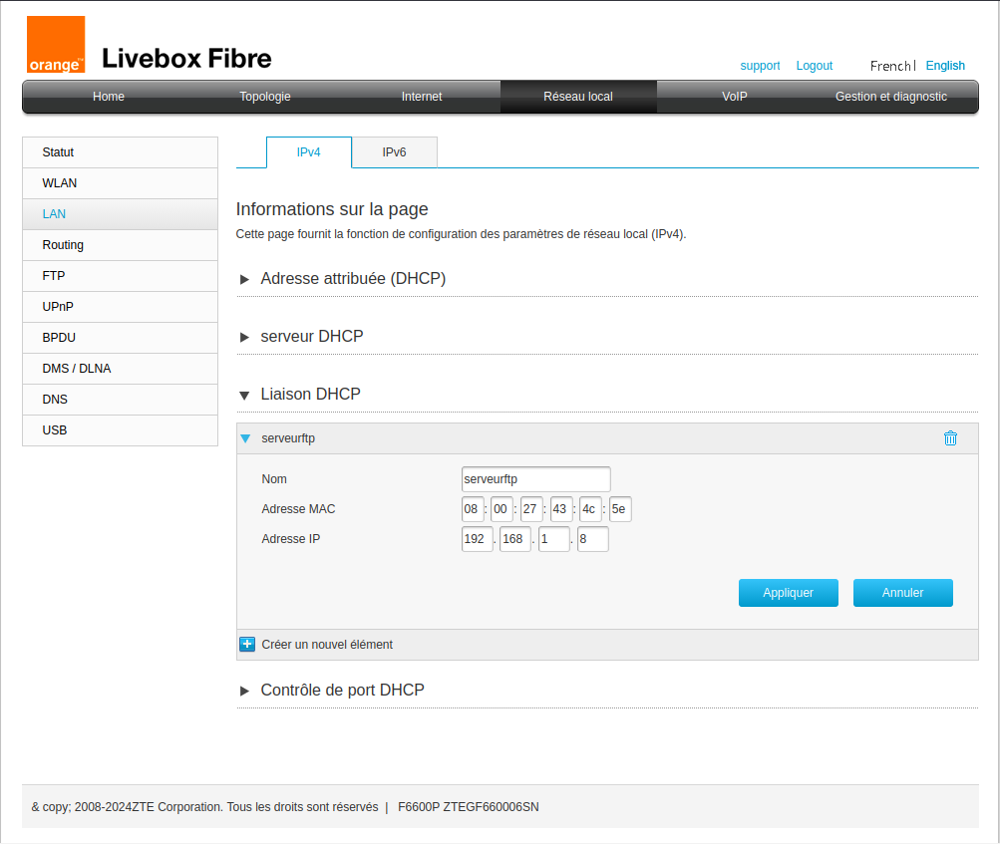
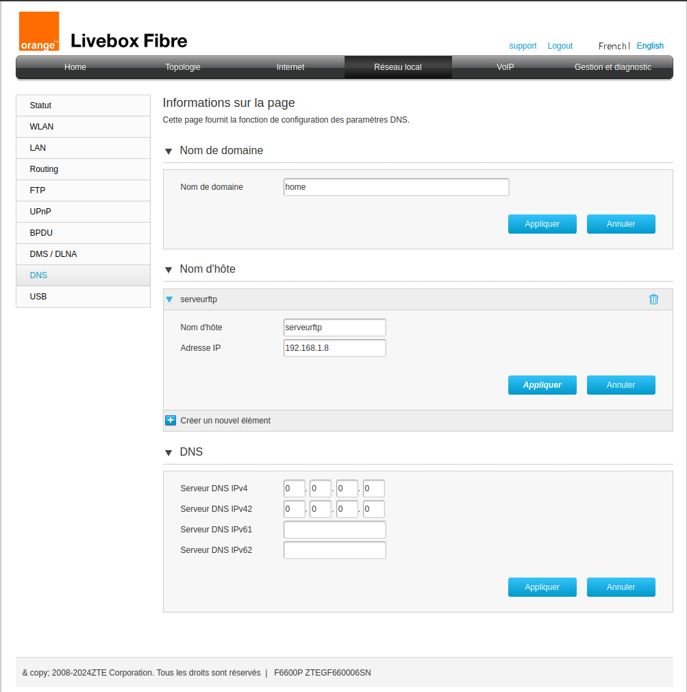

---

# Documentation Technique : Déploiement d'un serveur FTP et d'une application sur Debian 12 avec Reverse Proxy Nginx et Accès par Nom d'Hôte

Ce document décrit pas à pas la procédure d'installation et de configuration d'un environnement de production local sur une machine virtuelle Debian 12, incluant la configuration réseau fixe, l'installation de Docker, le déploiement d'un serveur FTP conteneurisé, le déploiement d'une application web, la mise en place d'un reverse proxy Nginx et la résolution de nom d'hôte locale via la box internet.

---

## 1. Configuration Réseau et Système (IP Fixe & Hostname)

### Configuration d'une adresse IP statique (NetworkManager)

Pour attribuer une adresse IP fixe (`192.168.1.8`) à l'interface réseau principale :

```bash
sudo nmcli connection modify "Wired connection 1" ipv4.addresses "192.168.1.8/24" ipv4.gateway "192.168.1.1" ipv4.dns "8.8.8.8,1.1.1.1" ipv4.method "manual"
sudo nmcli connection up "Wired connection 1"

```

* **Vérification :** La commande `ip addr show enp0s3` doit afficher l'adresse `192.168.1.8` sur l'interface réseau active.


### Définition du nom d'hôte (Hostname)

Nommez la machine `serveurftp` pour l'identifier facilement sur le réseau :

```bash
sudo hostnamectl set-hostname serveurftp

```

* **Vérification :** Tapez `hostname` pour vous assurer que le terminal retourne bien `serveurftp`.

---

## 2. Configuration de la Box Internet (Livebox / Routeur)

Pour permettre aux autres équipements du réseau local d'accéder à la machine via son nom d'hôte :

1. Accédez à l'interface d'administration de votre box (`[http://192.168.1.1](http://192.168.1.1)`).
2. Dans la section **Réseau local > DHCP (Liaisons DHCP)**, associez l'adresse MAC de votre VM à l'adresse IP fixe `192.168.1.8` avec le nom `serveurftp`.



3. Dans la section **Réseau local > DNS**, assurez-vous que le nom d'hôte `serveurftp` pointe bien vers l'adresse IP `192.168.1.8` (le domaine local par défaut étant `.home`, le nom complet sera `serveurftp.home`).



* **Vérification :** Depuis un autre poste sur le réseau, un `ping serveurftp.home` doit répondre avec l'adresse `192.168.1.8` sans perte de paquets.


---

## 3. Installation de Docker et Docker Compose

Pour exécuter des services conteneurisés :

1. Installez les prérequis de sécurité et de transport :
```bash
sudo apt update
sudo apt install ca-certificates curl -y

```


2. Ajoutez la clé GPG officielle de Docker :
```bash
sudo install -m 0755 -d /etc/apt/keyrings
sudo curl -fsSL https://download.docker.com/linux/debian/gpg -o /etc/apt/keyrings/docker.asc
sudo chmod a+r /etc/apt/keyrings/docker.asc

```


3. Ajoutez le dépôt Docker aux sources APT :
```bash
sudo tee /etc/apt/sources.list.d/docker.sources <<EOF
Types: deb
URIs: https://download.docker.com/linux/debian
Suites: $(. /etc/os-release && echo "$VERSION_CODENAME")
Components: stable
Architectures: $(dpkg --print-architecture)
Signed-By: /etc/apt/keyrings/docker.asc
EOF

```


4. Installez le moteur Docker et les plugins nécessaires :
```bash
sudo apt update
sudo apt install docker-ce docker-ce-cli containerd.io docker-buildx-plugin docker-compose-plugin -y

```


5. Ajoutez votre utilisateur courant au groupe `docker` pour exécuter les commandes sans `sudo` :
```bash
sudo usermod -aG docker $USER
newgrp docker

```


* **Vérification :** La commande `docker --version` doit retourner la version installée de Docker.


---

## 4. Déploiement du Serveur FTP Conteneurisé

Le serveur FTP est déployé en premier à l'aide de Docker Compose pour gérer le stockage et les transferts de fichiers.

1. Créez un dossier dédié au projet et accédez-y :
```bash
mkdir -p ~/Desktop/tandem/ftp-docker
cd ~/Desktop/tandem/

```


2. Créez le fichier de configuration `docker-compose-ftp.yml` :
```yaml
services:
  ftp:
    image: delfer/alpine-ftp-server
    ports:
      - "0.0.0.0:2001:21"
      - "0.0.0.0:21000-21010:21000-21010"
    environment:
      USERS: "ftpcloud|ChangeMe123!|/home/ftpcloud"
      ADDRESS: "0.0.0.0"
      MIN_PORT: "21000"
      MAX_PORT: "21010"
    volumes:
      - ./ftp-docker:/home/ftpcloud

```


3. Lancez le conteneur FTP en arrière-plan :
```bash
docker compose -f docker-compose-ftp.yml up -d

```


* **Vérification :** La commande `docker ps` doit lister le conteneur `ftp` avec le statut `Up` et les ports mappés correctement.


---

## 5. Déploiement de l'Application Tandem

Une fois le serveur FTP en service, déployez l'application principale écoutant sur le port local `3000` :

```bash
docker run -d --name tandem -p 3000:3000 --env-file .env.local -v tandem-data:/app/data betzalel7/tandem:latest

```

* **Vérification :** `docker ps` doit afficher le conteneur `tandem` actif et fonctionnel.

---

## 6. Installation et Configuration du Reverse Proxy Nginx

### Installation de Nginx

```bash
sudo apt update
sudo apt install nginx -y

```

### Nettoyage de la configuration par défaut

Supprimez le site par défaut pour éviter les conflits sur le port 80 :

```bash
sudo rm /etc/nginx/sites-enabled/default

```

### Création du fichier de configuration pour l'application

Créez et éditez un fichier de configuration dédié (ex: `/etc/nginx/sites-available/mon-application`) :

```nginx
server {
    listen 80;
    server_name serveurftp serveurftp.home 192.168.1.8;

    location / {
        proxy_pass http://127.0.0.1:3000;
        proxy_http_version 1.1;
        proxy_set_header Upgrade $http_upgrade;
        proxy_set_header Connection 'upgrade';
        proxy_set_header Host $http_host;
        proxy_cache_bypass $http_upgrade;
    }
}

```

### Activation du site via un lien symbolique

Créez le lien vers le dossier `sites-enabled` :

```bash
sudo ln -s /etc/nginx/sites-available/mon-application /etc/nginx/sites-enabled/

```

* **Vérification :** La commande `ls -l /etc/nginx/sites-enabled/mon-application` doit pointer directement vers le fichier disponible.

### Validation et redémarrage de Nginx

Testez la syntaxe du fichier de configuration :

```bash
sudo nginx -t

```

* **Vérification :** Le terminal doit afficher `syntax is ok` et `test is successful`.

Rechargez le service Nginx pour appliquer les modifications :

```bash
sudo systemctl reload nginx

```

* **Vérification :** La commande `sudo systemctl status nginx` doit retourner un état actif (`running`).

---

## 7. Vérification Finale

Depuis n'importe quel poste client de votre réseau local, ouvrez un navigateur web et accédez directement à l'application en utilisant le nom d'hôte configuré :

* `http://serveurftp`
* ou `[http://serveurftp.home](http://serveurftp.home)`

